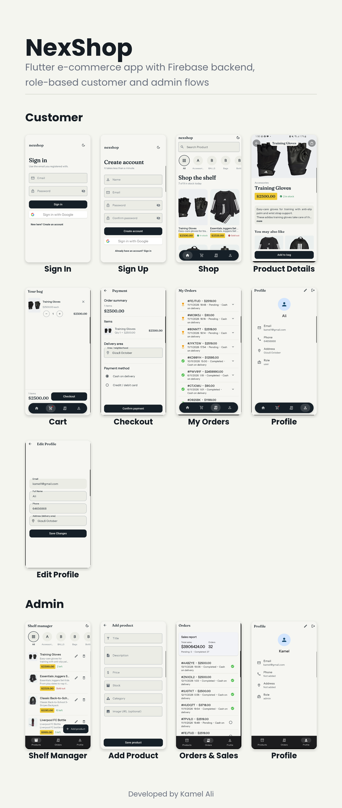

# NexShop

A Flutter e-commerce app with a Firebase backend, featuring separate customer and store management experiences, role-based access, and a light/dark theme.

## Features

### Customer
- Email/password sign-up and sign-in, with Google sign-in
- Browse products by category, with live search
- Product details and a shopping cart
- Product details screen with a collapsing app bar that shows the product name on scroll
- Animated "add to bag" effect that flies the product image into the cart icon
- Bouncing scroll physics with image stretch on pull
- "You may also like" grid with related products from the same category
- Expandable product descriptions with "Show more" / "Show less"
- Animated transition from product cards to product details
- Light and dark theme support across the product screens 
- Checkout with delivery area and payment method selection (cash on delivery)
- Order history with status tracking
- Profile management (name, phone, delivery address)
- Shimmer loading placeholders while data loads

### Store Management (Admin)
- Role-based access: admin users get the management screens, customers get the shop
- Manage products: list, edit, and delete
- Add new products with title, description, price, stock, category, and optional image URL
- View all orders with a sales report (total sales, order count, pending and completed totals)

### General
- Light and dark theme toggle

## Screenshots

## Tech Stack

- **Framework:** Flutter & Dart
- **Backend:** Firebase Authentication, Cloud Firestore
- **Data:** All products and user roles are stored in Firebase

## Getting Started

### Prerequisites
- Flutter SDK
- A Firebase project

### Installation

1. Clone the repository:
   ```bash
   git clone https://github.com/KamelAli545/<repo-name>.git
   cd <repo-name>
   ```

2. Install dependencies:
   ```bash
   flutter pub get
   ```

3. Connect the app to your Firebase project:
   ```bash
   flutterfire configure
   ```
   Or add `google-services.json` to `android/app/` manually.

4. Enable sign-in methods in Firebase Console:
   - Email/Password
   - Google (optional)

5. Run the app:
   ```bash
   flutter run
   ```

### Creating an Admin User

New accounts are customers by default. To make an account an admin, open Firestore in the Firebase Console, find that user's document, and set its `role` field to `admin`.

## Project Structure

```
lib/
├── ...           # Screens, widgets, and app logic
android/          # Android configuration
ios/              # iOS configuration
```

## Author

**Kamel Ali Kamel**
[LinkedIn](https://linkedin.com/in/kamel-ali03) · [GitHub](https://github.com/KamelAli545)
